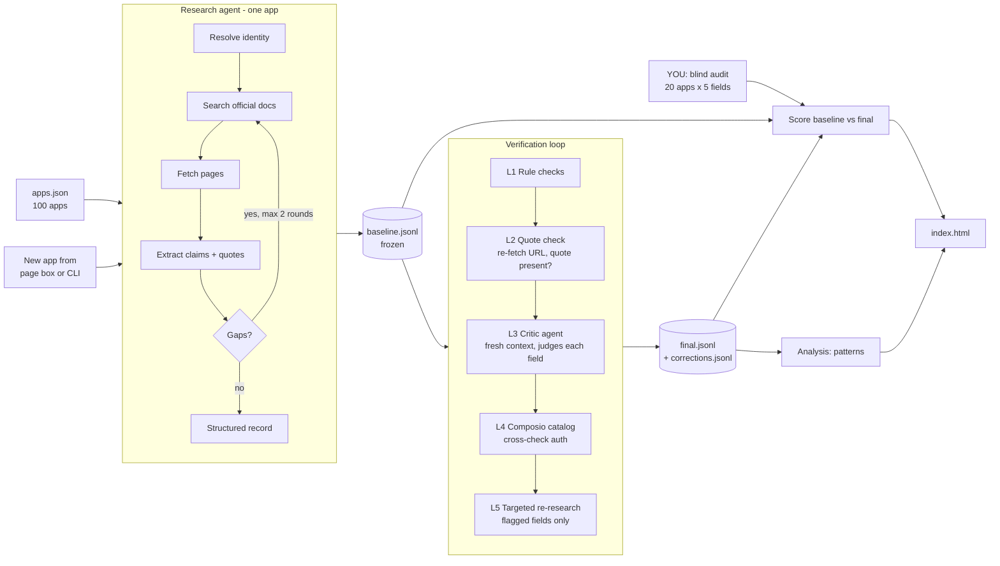

# Design: App Research Agent

> Version 1.0, 23 Nov 2026. Companion to [PLAN.md](PLAN.md). Builds on
> `Composio_Technical_Design.docx`, moved to TypeScript. Items marked
> **(preflight)** are assumptions until a real call confirms them.

## 1. Architecture



**One engine, two entry points.** The batch CLI, the local UI and the hosted box all
call the same `researchApp(app)` function. A new app gets the same agent, the same
schema, and verification layers L1–L5. Only the human audit is missing for it, and the
page says so.

## 2. Components

| Component | File | What it does |
|---|---|---|
| Input list | `data/apps.json` | `{id, name, category, hint}` × 100, copied exactly from the brief |
| Research agent | `src/agent/research.ts` | Claude Agent SDK `query()` with a strict prompt and limited tools. Returns JSON checked with zod. Invalid output gets one repair retry. |
| Tools | `src/agent/tools.ts` | **Composio** session tools for web search and page fetch **(preflight: which toolkit, e.g. Exa / Firecrawl / Tavily)**. Built-in `WebFetch` as fallback, logged when used. No shell or file-write tools. |
| Batch runner | `src/cli.ts research` | Runs 3 apps at a time with a per-app time cap of about 4 minutes. Saves after each app, resumes after a crash, logs tokens and time. |
| Verifier | `src/verify/*.ts` | Layers L1–L5 below. Every change goes to `corrections.jsonl`. |
| Scoring | `src/evaluate.ts` | Compares baseline and final with `audit/human.csv` and outputs C / I / U counts per field |
| Analysis | `src/analyze.ts` | Computes the pattern numbers from `final.jsonl` |
| Page renderer | `src/render.ts` → `site/index.html` | One self-contained HTML file with the data embedded. Works with no backend. |
| Local server | `src/server.ts` | `npm run ui`: serves the page on localhost plus `POST /api/research {name, hint}`. Streams progress, then returns the record. |

### Why Claude Agent SDK
It provides the agent loop (decide → call a tool → read → decide again) without writing
that loop by hand. It runs on your Claude Code login locally, and on `ANTHROPIC_API_KEY`
when hosted. Composio tools plug in as an **MCP server**. That way we use both
Composio's SDK (to create the session) and Composio's MCP (to expose the tools to the
agent), which fits the "use Composio's SDK and MCP" hint in the brief.

## 3. The record (one per app)

```ts
AppRecord {
  id, name, category, run_id, researched_at, pass: "baseline" | "final"
  identity:   { canonical_name, website, docs_url, note? }
  summary:    string                                   // one line: what it does
  auth: {
    methods:  ("oauth2"|"api_key"|"bearer_token"|"basic"|"jwt"|"none"|"other")[]
    detail:   string                                   // e.g. "OAuth2 auth-code; personal API key for scripts"
    claims:   Claim[]
  }
  access: {
    dev_access:   "free" | "free_trial" | "paid_plan" | "admin_approval" | "app_review" | "partner_or_sales" | "not_applicable" | "unknown"
    production:   same enum                            // sandbox free, production gated is common
    gates:        string[]                             // every condition, e.g. "Enterprise plan for API"
    claims:   Claim[]
  }
  api: {
    types:    ("rest"|"graphql"|"sdk"|"cli"|"webhooks"|"soap"|"none_found")[]
    breadth:  "narrow" | "moderate" | "broad" | "unknown"  // 1-2 / 3-5 / 6+ resource families
    resource_families: string[]                          // e.g. ["contacts","deals","notes"]
    claims:   Claim[]
  }
  mcp: {
    status:   "official" | "community" | "announced" | "none_found" | "unknown"
    url?:     string
    claims:   Claim[]
  }
  composio_toolkit: "exists" | "not_found" | "unknown"   // from Composio's catalog, not the LLM
  verdict:    "build_now" | "build_with_conditions" | "outreach_required" | "limited" | "needs_research"
  blocker:    string | null                             // main blocker, plain words
  confidence: "high" | "medium" | "low"
  open_questions: string[]
}
Claim { text, source_url, quote }  // quote = short verbatim passage from the page
```

**Rule:** every claim carries the URL **and a short verbatim quote** from that page. The
quote is what makes automatic checking possible (layer L2).

### Verdict rubric (applied the same way by the agent, the critic and you)

| Verdict | Meaning |
|---|---|
| **Build now** | Useful API + a developer can get credentials for free or on a trial, with no unresolved gate |
| **Build with conditions** | Feasible, but needs a named thing: paid plan, customer admin, app review for production |
| **Outreach required** | A partnership or sales conversation is needed before any access |
| **Limited** | Positive evidence of a material restriction (no public API, read-only, deprecated) |
| **Needs research** | Evidence missing or conflicting. Absence from search ≠ no API. |

Breadth: narrow = 1–2 resource families, moderate = 3–5, broad = 6+.

## 4. Verification loop (how accuracy goes up)

| Layer | Type | Checks | On failure |
|---|---|---|---|
| **L1 Rules** | code | 100 unique IDs; schema; logic, e.g. `build_now` with `dev_access=partner_or_sales` is contradictory; `official` MCP with a URL on a non-vendor domain is suspect; `high` confidence with 0 claims | flag field |
| **L2 Quote check** | code | Re-fetch each `source_url`, check the page loads and the quote appears (normalised fuzzy match) | flag claim as "unsupported" |
| **L3 Critic agent** | LLM, separate prompt, fresh context | Gets the record + fetched page text. Per field: supported / contradicted / insufficient, with reason. Told to look for **missing conditions** (e.g. "free" but needs Enterprise). | flag field |
| **L4 Composio cross-check** | API | If Composio already has a toolkit for the app, compare its auth schemes with ours. **Independent of our agent.** | flag disagreement (not auto-overwrite) |
| **L5 Re-research** | agent | Re-runs only the flagged fields with the critic's objection in the prompt. Max 1 round. | if still unclear → `needs_research` / `unknown` |
| **L6 Human audit** | you | 20 apps × 5 fields, blind. Scores baseline and final. | corrections logged with reviewer = human |

`baseline.jsonl` is never edited. Every change to a field goes to `corrections.jsonl`
as `{app_id, field, before, after, layer, reason, evidence_url}`. This gives the page its
"what the loop fixed" examples and the **baseline → final** accuracy comparison.

Optional, if time allows: a **browser check** (the in-app browser opens pages
that a plain fetch can't read because they need JavaScript), for L2 failures only.

## 5. Researching new apps (local only; decision D4)

```
npm run ui  →  http://localhost:8787  (same page + live "Research any app" box)
   box ──POST /api/research {name, hint?}──► server.ts (localhost only)
    ▲                                          │
    └── streamed progress + result card ◄── researchApp() + L1–L3 verification
```

- The server binds to `127.0.0.1` only. Keys come from the user's own `.env` or
  Claude Code login.
- The **deployed** page is static. Its "Try any app" section shows the two commands
  and 2–3 **recorded** runs of apps outside the 100 (input, trace summary, result
  card), each labelled *"recording of a local run on <date>"*.
- New-app results are labelled *"automated verification only, not human audited"*.
- To make it hosted later, deploy `server.ts` as a Node service (Render/Railway) with
  an `ANTHROPIC_API_KEY`. No code changes are needed.

## 6. Repository layout and commands

```
composio-app-research/
  README.md  .env.example  package.json  tsconfig.json
  docs/PLAN.md  docs/DESIGN.md
  data/apps.json
  prompts/research.md  prompts/critic.md          # versioned prompts
  src/agent/  src/verify/  src/cli.ts  src/server.ts  src/analyze.ts  src/render.ts  src/evaluate.ts
  runs/<run_id>/ baseline.jsonl  final.jsonl  corrections.jsonl  trace.jsonl  meta.json
  audit/ sample.json (seed + picks)  human.csv  scores.json
  site/index.html                                  # generated
```

```bash
npm run preflight                         # one Composio search + one fetch + auth check
npm run research -- --app "Attio"         # single app, prints record
npm run research -- --all --concurrency 3 # 100 apps, resumable
npm run verify  -- --run <id>             # L1-L5 -> final.jsonl
npm run evaluate -- --run <id>            # scores vs audit/human.csv
npm run render  -- --run <id>             # site/index.html, no network needed
npm run ui                                # local page with the research box
```

## 7. Preflight results (23 Nov 2026, 18:00 IST, `npm run preflight`)

| Check | Result |
|---|---|
| Composio search: `KEENABLE_SEARCH_WEB_PUBLIC` | PASS: 8 results, top hit was Attio's official auth page |
| Composio fetch: `KEENABLE_FETCH_URL_PUBLIC` | PASS: 7,045 chars of markdown |
| Tavily / Firecrawl / Exa via Composio | Need a connected account (their own API key). **Not used.** |
| Composio catalog `toolkits.get(slug)` | PASS: returns Composio-supported auth modes. **Attio shows only `OAUTH2`, but Attio's docs also offer API keys**, so the L4 rule is "Composio's modes ⊆ our methods", not equality |
| Agent SDK (Sonnet) + our Composio-backed MCP tools | PASS: 2 tool calls, correct answer with a verbatim quote |

**How Composio is wired (the honest version):** the agent calls two MCP tools
(`web_search`, `fetch_page`) that we serve in-process. Their handlers call
`session.execute()` on Composio's SDK. We chose this over pointing the agent at
Composio's hosted MCP URL because it lets us **cache every fetched page**, which L2 and
the critic re-read. It also lets us cap calls per app and log a trace. The hosted MCP
URL was created and works (`session.mcp.url`). It just isn't the main path.

**Lessons from preflight:**
- The agent listed "Bearer" and "Basic" as auth methods for Attio. Those are *how the
  token is sent*, not *how you get it*. The schema separates `methods` (how you get
  credentials) from transport notes.
- One trivial question cost about $0.46 (notional, billed to the subscription), mostly
  Claude Code's default system prompt. We'll pass our own short system prompt and no
  setting sources to cut per-app tokens before the 100-app run.

## 8. Risks

| Risk | Response |
|---|---|
| Composio search/fetch toolkit not available on free tier or has changed | Preflight first. If blocked, use Agent SDK's built-in WebSearch/WebFetch and **say so on the page** |
| Claude Code subscription rate limits during a 100-app batch | Concurrency 3, resume support, cap on tool calls per app. Fall back to an API key if limits are hit. |
| Docs need JavaScript / block bots | Try other official pages (help centre, GitHub). Browser check. Otherwise `unknown` with the reason. |
| Wrong product (Close, Plain, Grain, Sherlock are common words) | Identity step uses the hint domain. Critic checks the identity. |
| Agent claims certainty without evidence | Claims need quote + URL, L2 checks the quotes exist, low confidence → `needs_research` |
| Prompt injection from fetched pages | Pages are treated as data. No tools that write files or run shell commands. |
| Secrets leak | `.env` git-ignored. Traces redacted. Page built only from data files. |
